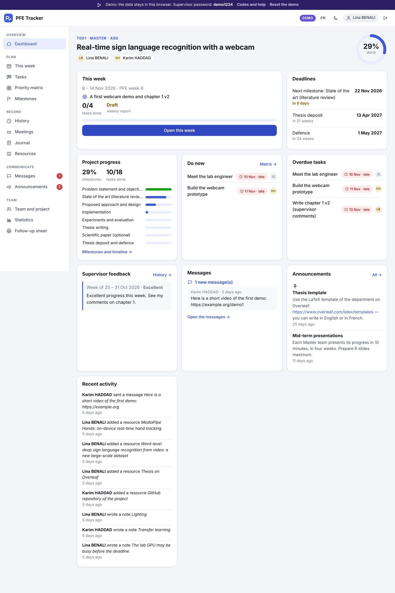
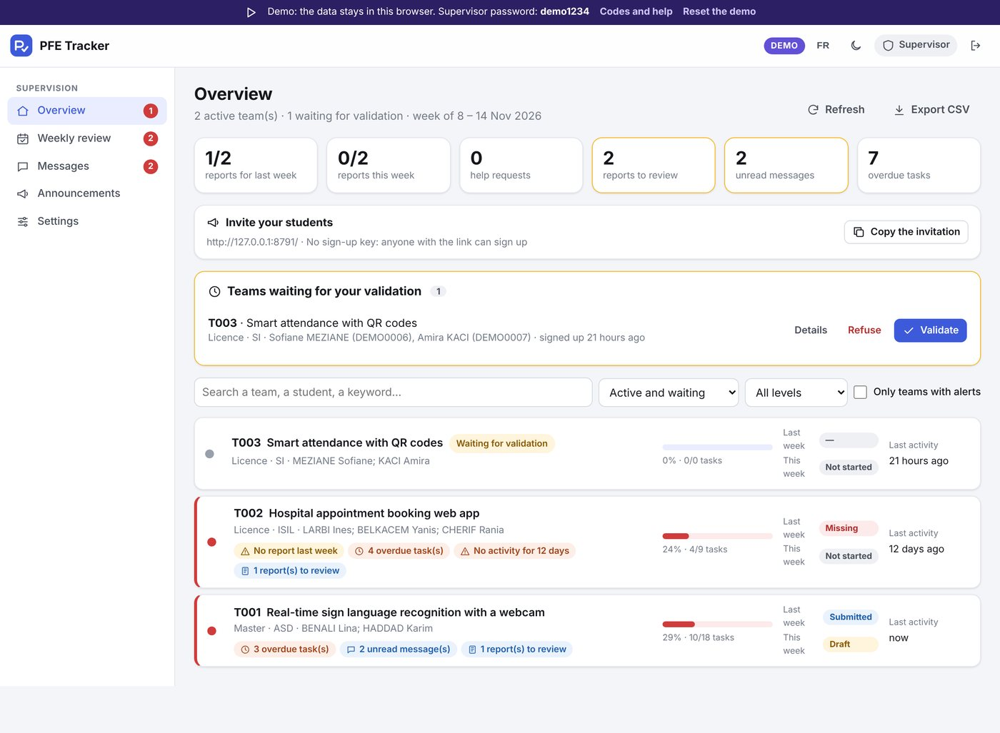

# PFE Tracker

Week-by-week follow-up of final-year projects (PFE, Licence and Master).
Students plan their week, say what is done and what is not (and why), set priorities and record their work;
the supervisor sees every team on one page, with alerts, and gives feedback.

- **Website:** static pages on GitHub Pages (this repository — public code).
- **Database:** a private Google Sheet, behind a small Google Apps Script (`backend/Code.gs`).
- **No server to rent, no account to create for the students:** each team uses an access code.

**Try it:** open the site with `?demo=1` (for example `https://yousra1991.github.io/pfe-tracker/?demo=1`).
The demo runs the real server code inside your browser with three sample teams; nothing is sent anywhere.
Supervisor password in the demo: `demo1234`.



## What the students get

| | |
|---|---|
| **Team account** | One account per team: project title, level, specialty, members (1 to 3 by default). The team receives an **access code** (`K7M2-Q9TX`), shown once and sent by email to the members. |
| **This week** | Goal of the week, planned tasks, status of each task. A task **not done** needs an **obstacle type** and a **reason**. Weekly report: what was done, difficulties, plan for next week, hours per member, confidence (1–5), request for help. Unfinished tasks can be carried over to the next week; their history stays in the report. |
| **Tasks** | Board (To do · In progress · To review · Blocked · Done) with drag and drop, list view, filters, checklists, due dates, estimates and time spent, a 25-minute focus timer. |
| **Priority matrix** | Urgent / important matrix (Do now · Plan it · Delegate or do quickly · Later or drop) with drag and drop. |
| **Milestones and timeline** | Default milestones for Licence and Master (editable), progress, deadlines and a Gantt-style timeline. |
| **Meetings, journal, resources** | Meeting minutes (actions turn into tasks), notes / ideas / risks, links, bibliography and deliverables submitted for review. |
| **Messages and announcements** | Conversation with the supervisor; announcements for every team or one level. |
| **Statistics and follow-up sheet** | Planned vs done tasks per week, hours, confidence, obstacles, contribution of each member; a printable PFE follow-up sheet with room for signatures. |

English and French interface, dark mode, works on phones.

## What the supervisor gets

- **Overview** of all teams, sorted by need of attention: help requested, missing report, overdue tasks, late milestones, inactivity, low confidence, unread messages, reports to review.
- **Validation** of new teams (sign-up key + approval), suspension, archiving, new access code, deletion.
- **Weekly review**: every team's report of a given week on one page, with the reasons of unfinished tasks, and a feedback box (comment + appreciation).
- **Each team's space** exactly as the students see it, plus a private note that students never see, and the verdict on deliverables.
- **Messages**, **announcements**, **settings** (calendar, default milestones, categories, emails), **CSV export**.
- Email notifications (new team, help requested, messages — each optional).



## How it works

```
 Students & supervisor (browser)            Google (supervisor's account)
 ┌─────────────────────────────┐   HTTPS   ┌──────────────────────────────┐
 │ GitHub Pages                │ ───────►  │ Apps Script web app          │
 │ index.html + assets/*.js    │  JSON     │ backend/Code.gs              │
 │ (public code, no data)      │ ◄───────  │   checks the code / password │
 └─────────────────────────────┘           │   reads & writes ──►  Google │
                                           │                       Sheet  │
                                           └──────────────────────────────┘
```

- The Google Sheet stays **private**: only the supervisor can open it. The website never sees it; it only receives what `Code.gs` returns.
- A team can read and change **only its own data**. Team codes are never stored in clear: only an HMAC of the code (with a secret kept in the script properties).
- The supervisor logs in with a password (salted and hashed); the session lasts 12 hours at most and ends when the password changes.
- Protection against abuse: sign-up key, approval of new teams, limits on sign-ups, wrong passwords, emails and changes per team, text sanitised before it reaches the sheet (no formula injection) and before it reaches the page (no HTML injection).

## Install (about 15 minutes, once)

### 1. The database (Google Sheet + Apps Script)

1. Create a Google Sheet (or use the one prepared for you).
2. **Extensions → Apps Script**. Delete the content, paste the whole of [`backend/Code.gs`](backend/Code.gs), **Save**.
3. Reload the Google Sheet. A menu **PFE Tracker** appears → **1. Install / repair** → allow the access → choose the **teacher password** (8 characters or more).
   The install creates the tabs and a **sign-up key** (tab *Config*, `registration_key`).
4. In Apps Script: **Deploy → New deployment → ⚙ → Web app**
   - *Execute as:* **Me**
   - *Who has access:* **Anyone**

   → **Deploy** → copy the **Web app URL** (it ends with `/exec`).

### 2. The website (GitHub Pages)

1. Put the files of this repository in a public GitHub repository (for example `pfe-tracker`).
2. Edit [`config.js`](config.js): paste the Web app URL in `API_URL`, commit.
3. **Settings → Pages → Build and deployment → Deploy from a branch → `main` / `(root)` → Save.**
4. After a minute the site is at `https://<your-account>.github.io/pfe-tracker/`.

### 3. First steps

1. Open the site → **Supervisor space** → your password.
2. **Settings**: your name, the start of the PFE, the deposit and defence dates (they number the weeks and spread the default milestones), the levels and specialties.
3. Overview → **Invite your students**: copy the invitation (website address + sign-up key) and send it to your students.

## Everyday use

- **New team:** it appears in *Teams waiting for your validation*. Check the members and matricules, then **Validate**.
- **Each week:** open **Weekly review**, read the reports (help requests first), write a short feedback and mark the week as reviewed.
- **Forgot the code:** the student uses *Forgot the code?* (a new code is emailed to all the members), or you open the team → **New code**.
- **End of the year:** **Archive** the teams (read-only), or delete them.
- **Backup:** in the Google Sheet, *File → Make a copy*.

## Updating the code

After any change of `Code.gs`: **Deploy → Manage deployments → ✏️ → Version: New version → Deploy**. The URL stays the same.
Changes of the website are online a minute after the commit.

## Limits

- Free Google quotas: Apps Script runs as the supervisor; Gmail allows about 100 email recipients per day on a personal account (emails are optional, everything works without them).
- A Google Sheet holds 10 million cells: years of data for a department.
- Answers take about one second (Apps Script).

## Development

No build step: the site is plain HTML, CSS and JavaScript.

```bash
node tests/backend.test.js          # backend: runs Code.gs in an Apps Script simulator (assets/gas-shim.js)
node tests/server.js &              # local server: website + backend on http://127.0.0.1:8791
node tests/e2e.js                   # end-to-end tests (Playwright)
node tests/demo.e2e.js              # demo mode
node tests/i18n-keys.js             # every interface text has a French translation
node tools/build-demo.js demo.html  # single-file demo page
```

| Path | Content |
|---|---|
| `index.html`, `config.js` | page shell, settings (`API_URL`) |
| `assets/core.js` | server calls, safe HTML templates, dates, dialogs |
| `assets/team.js`, `assets/admin.js`, `assets/app.js` | team space, supervisor space, navigation and sign-up |
| `assets/charts.js`, `assets/app.css`, `assets/i18n.js` | charts, styles, French translation |
| `assets/gas-shim.js`, `assets/demo.js` | Apps Script simulator and demo data |
| `backend/Code.gs` | the server (Google Apps Script) |

## Licence

MIT — see [LICENSE](LICENSE).
